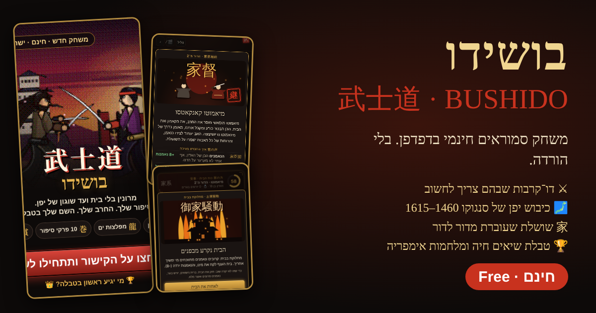

# Bushido · בושידו · 武士道

**A free samurai browser game set in Sengoku Japan (1460–1615).** No download, no sign-up: open the link and play, on a phone or a computer, in Hebrew or English.

### ▶ Play now: https://galscher.github.io/bushido/

- ⚔ **Duels where you have to think.** Clashes, stances (jōdan / chūdan / gedan), reading the enemy, ki strikes, shuriken. Spamming attack loses.
- 🗾 **Conquer Japan.** Provinces, castles, armies, food supplies, levies from the realm. Battles from Okehazama to Sekigahara and the siege of Ōsaka.
- 家 **A dynasty that outlives you.** Marriage alliances, heirs with inherited traits, adoption, retirement (inkyo), succession quarrels, a drawn family tree. Each ancestor leaves a legacy.
- 🏆 **A live leaderboard and empire wars.** Challenge the player right above you. Your empire fights for you 24/7, even when you're offline.
- 🍵 **The culture of the age.** Tea ceremony, Noh, renga, kemari, famous tea utensils, clan crests, armour, torii and edicts.
- ∞ **An autopilot that never stops.** Turn it on and your house keeps growing day and night.

---

**משחק סמוראים חינמי בדפדפן**, בלי הורדה ובלי הרשמה. אפשר לשחק בו בעברית או באנגלית.

- דו־קרבות שבהם צריך לחשוב.
- כיבוש יפן של תקופת סנגוקו.
- שושלת שעוברת מדור לדור.
- טבלת שיאים חיה ומלחמות אימפריה.

▶ **לשחק עכשיו:** https://galscher.github.io/bushido/

© 2026 Bushido Dojo. כל הזכויות שמורות. All rights reserved.
